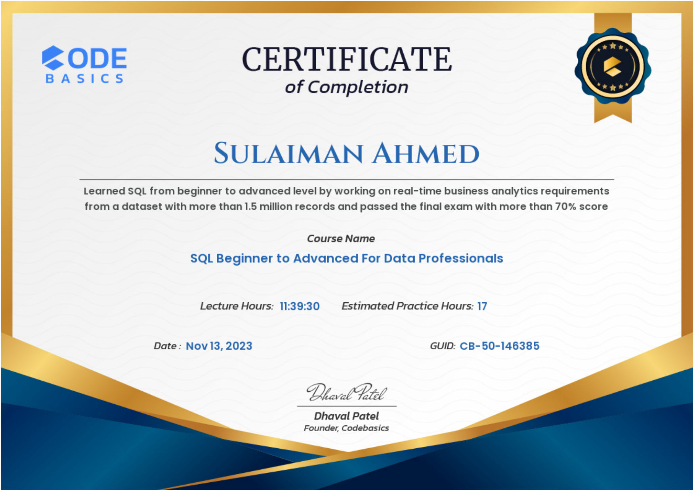
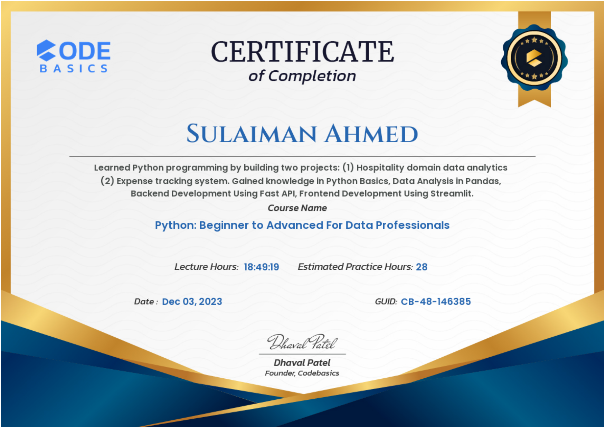

# Codebasics certificates

Certificates of completion earned by Sulaiman Ahmed on the Codebasics data-professional track in 2023. The original PDFs are in this repository; the GUID printed on each certificate can be checked with Codebasics.

| Date | Course | Lecture hours | Certificate ID |
|---|---|---|---|
| 10 Oct 2023 | Excel: Mother of Business Intelligence | 9h 27m | CB-51-146385 |
| 21 Oct 2023 | Get Job Ready: Power BI Data Analytics for All Levels 4.0 (includes a Microsoft Fabric migration project) | 22h 21m | CB-49-146385 |
| 13 Nov 2023 | SQL: Beginner to Advanced for Data Professionals | 11h 40m | CB-50-146385 |
| 3 Dec 2023 | Python: Beginner to Advanced for Data Professionals | 18h 49m | CB-48-146385 |

Issued by Codebasics (Dhaval Patel, Founder).

## Excel: Mother of Business Intelligence (10 Oct 2023)

## Get Job Ready: Power BI Data Analytics for All Levels 4.0 (21 Oct 2023)

## SQL: Beginner to Advanced for Data Professionals (13 Nov 2023)

## Python: Beginner to Advanced for Data Professionals (3 Dec 2023)

